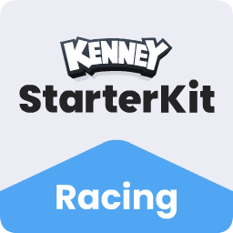
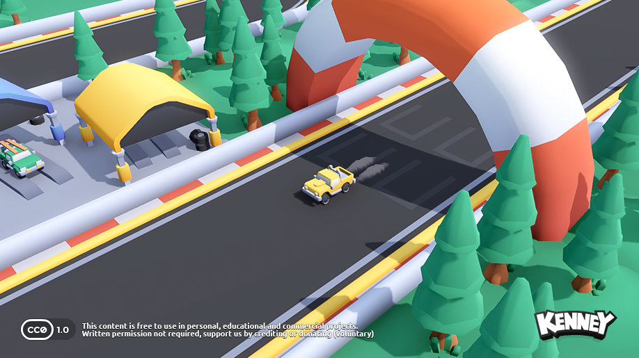

# Starter Kit Racing（赛车起步模板）

fork from https://github.com/KenneyNL/Starter-Kit-Racing.git

这是一个基于 **Godot 4.8（.NET / C#）** 的赛车游戏起步模板，包含一套完整的街机风格驾驶手感和赛道搭建方案。

> 脚本语言为 C#：车辆 `scripts/Vehicle.cs`、摩托车 `scripts/VehicleMotorcycle.cs`、相机 `scripts/View.cs`。修改脚本后需要在编辑器里执行 **项目 → 构建**。

## 包含特性

- 街机风格的车辆操控
- 轮胎打滑烟雾特效
- 基于 GridMap 的赛道搭建
- 3D 模型与音效资源（CC0 授权）

## 截图

## 操作方式

| 按键 | 功能 |
| --- | --- |
| <kbd>W</kbd> | 加速 / 刹车 |
| <kbd>S</kbd> | 刹车 / 倒车 |
| <kbd>A</kbd> <kbd>D</kbd> | 转向 |

## 使用指南

### 1. 如何调整赛道？

选中 `GridMap` 节点，在世界里摆放预制的地块即可。

### 2. 如何更换车辆模型？

从项目自带的载具中任选一个（例如 `vehicle-truck-yellow.glb`），把它拖进场景，作为 `Container` 的子节点，然后把节点名改成 `Model`。

### 3. 如何添加自定义车模？

按上面的步骤操作，但要确保你的模型包含以下子节点：

- `body` 车身
- `wheel-front-left` 左前轮
- `wheel-front-right` 右前轮
- `wheel-back-left` 左后轮
- `wheel-back-right` 右后轮

### 4. 如何从汽车换成摩托车？

从主场景中移除 `Vehicle` 节点，找到 `vehicle-motorcycle.tscn` 场景并放进主场景，然后把 `View` 节点的 **Target** 属性重新指向新的载具（C# 导出属性名首字母大写）。

## 文档

完整的项目分析与开发指南见 [`docs/`](docs/README.md) 目录：

| 文档 | 内容 |
| --- | --- |
| [项目概览](docs/01-项目概览.md) | 技术规格、整体架构、设计亮点 |
| [快速开始](docs/02-快速开始.md) | 运行方式、操作说明、编辑器操作步骤 |
| [目录结构](docs/03-目录结构.md) | 各文件夹与资源的用途 |
| [车辆系统](docs/04-车辆系统.md) | 球体代理物理原理、特效系统、扩展方式 |
| [脚本参考](docs/05-脚本参考.md) | C# 脚本清单、状态字段与可扩展方法 |
| [赛道与场景](docs/06-赛道与场景.md) | 主场景构成、GridMap、环境与相机 |
| [项目设置](docs/07-项目设置.md) | 输入映射、渲染、物理、.NET、启动画面 |
| [已知问题与改进建议](docs/08-已知问题与改进建议.md) | 现有缺陷清单与修复思路 |

## 许可

MIT License

Copyright (c) 2026 Kenney

Permission is hereby granted, free of charge, to any person obtaining a copy of this software and associated documentation files (the "Software"), to deal in the Software without restriction, including without limitation the rights to use, copy, modify, merge, publish, distribute, sublicense, and/or sell copies of the Software, and to permit persons to whom the Software is furnished to do so, subject to the following conditions:

The above copyright notice and this permission notice shall be included in all copies or substantial portions of the Software.

THE SOFTWARE IS PROVIDED "AS IS", WITHOUT WARRANTY OF ANY KIND, EXPRESS OR IMPLIED, INCLUDING BUT NOT LIMITED TO THE WARRANTIES OF MERCHANTABILITY, FITNESS FOR A PARTICULAR PURPOSE AND NONINFRINGEMENT. IN NO EVENT SHALL THE AUTHORS OR COPYRIGHT HOLDERS BE LIABLE FOR ANY CLAIM, DAMAGES OR OTHER LIABILITY, WHETHER IN AN ACTION OF CONTRACT, TORT OR OTHERWISE, ARISING FROM, OUT OF OR IN CONNECTION WITH THE SOFTWARE OR THE USE OR OTHER DEALINGS IN THE SOFTWARE.

本包含中的所有素材（2D 精灵图、3D 模型与音效）均采用 [CC0 授权](https://creativecommons.org/publicdomain/zero/1.0/)。

刹车打滑音效由 [Landeplage](https://github.com/Landeplage) 制作，同样采用 CC0 授权。
